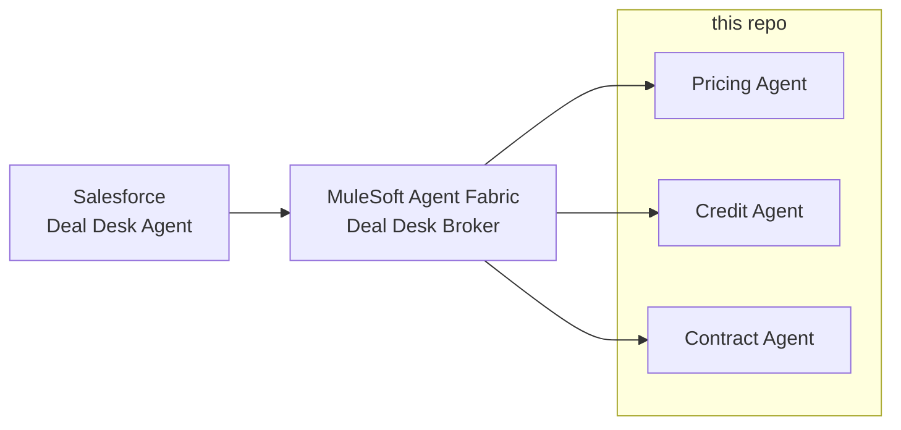

# deal-desk-agents

Mock enterprise agents for the **Deal Desk** demo. They speak the [A2A protocol](https://a2a-protocol.org) (v0.3, JSON-RPC).

One Express server hosts three agents. Each agent pretends to be a back-office system:

| Agent | Path | Pretends to be | What it answers |
|---|---|---|---|
| Pricing Agent | `/pricing` | ERP / Finance | Is X% discount allowed on deal Y? Returns the decision and the margin impact |
| Credit Agent | `/credit` | Credit bureau / AR | Is the customer creditworthy? Returns risk, payment history, the credit limit check and a recommendation |
| Contract Agent | `/contract` | Legal / CLM | Drafts contract terms and returns a draft ID (`CTR-…`), template, final price and terms |

These agents are the bottom layer of the demo:



| Repo | Layer |
|---|---|
| [deal-desk-salesforce](https://github.com/deepshikhalmp-dot/deal-desk-salesforce) | Agentforce agent and Apex action that sales reps use |
| [deal-desk-network](https://github.com/deepshikhalmp-dot/deal-desk-network) | Agent Fabric network and broker that call these agents |
| **deal-desk-agents** (this repo) | The three mock A2A agents |

## Business rules

All demo data is in [`data.js`](data.js).

**Discount policy (Pricing Agent).** The same policy applies to every deal:

| Requested discount | Decision |
|---|---|
| Up to 15% | `APPROVED`, within the rep's limit |
| Over 15%, up to 25% | `VP APPROVAL REQUIRED` |
| Over 25% | `NOT ALLOWED` |

Margin after the discount is reported for information only. It does not change the decision.

**Credit (Credit Agent).** It recommends secured terms (advance payment) when the customer's risk is `HIGH` or the deal amount exceeds the credit limit. Otherwise it approves standard terms.

**Contract template (Contract Agent):**
1. `secured` when the customer is high risk or the caller asks for secured terms.
2. Otherwise `extended` (3-year commitment) when the discount is over 15%.
3. Otherwise `standard`.

It refuses to draft anything above 25%.

**Demo deals:**

| Deal ID | Customer | Amount | Margin | Credit |
|---|---|---|---|---|
| `ACME-Q4` | Acme Retail | ₹50,00,000 | 35% | LOW risk, limit ₹80,00,000 |
| `GLOBEX-Q4` | Globex Corp | ₹20,00,000 | 22% | HIGH risk, limit ₹10,00,000 |

The credit data includes fake PAN numbers in clear text **on purpose**. The Agent Fabric network masks them at the gateway (`AAACA1234F` → `AAACA****F`) before the broker or the LLM sees them. This shows a governance policy at work.

## Endpoints

| Method | Path | Purpose |
|---|---|---|
| `GET` | `/` | Lists the agents and their card URLs |
| `GET` | `/health` | Returns `{"status":"UP"}` |
| `GET` | `/<agent>/.well-known/agent-card.json` | A2A agent card |
| `POST` | `/<agent>` | A2A JSON-RPC, method `message/send` |

The static copies in [`agent-cards/`](agent-cards) match the cards that were registered in the Agent Fabric network.

## Run locally

```bash
npm install
npm start          # http://localhost:3000
```

Example request:

```bash
curl -s http://localhost:3000/pricing \
  -H 'Content-Type: application/json' \
  -d '{"jsonrpc":"2.0","id":"1","method":"message/send",
       "params":{"message":{"role":"user","messageId":"m1",
       "parts":[{"kind":"text","text":"Can ACME-Q4 get 20% discount?"}]}}}'
```

Reply text: `VP APPROVAL REQUIRED. ACME-Q4 (Acme Retail): 20% discount = ₹10,00,000 off ₹50,00,000. Margin drops from 35% to 18.8%. …`

## Deployment

The service is hosted on Render at `https://deal-desk-agents.onrender.com`. Render **auto-deploys from `main`**, so every push to `main` changes the live demo within seconds. Avoid pushing just before a demo.

The free tier sleeps when idle, so the first call after a quiet period can take up to a minute.

Requirements: Node.js 20 or later. The only dependency is `express`.
